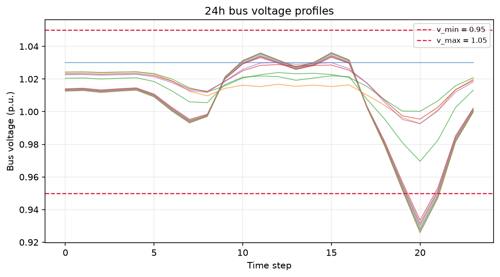
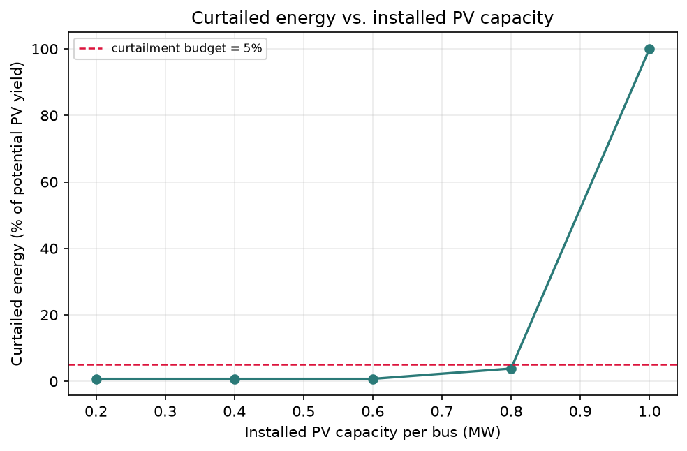
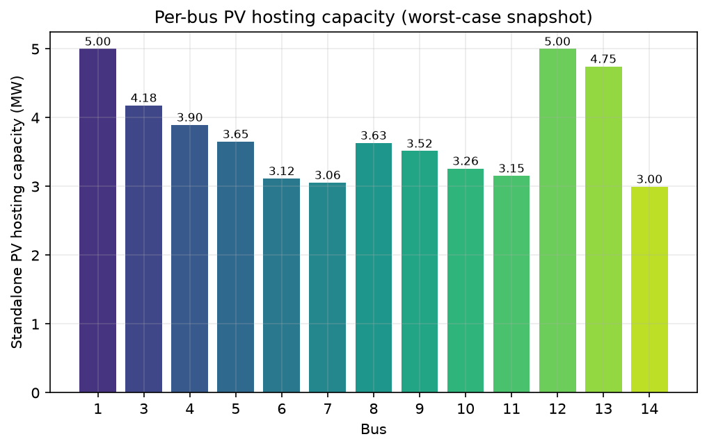

# Renewable Hosting Capacity & Bottleneck Analysis

Time-series AC power flow study of how much solar PV a medium-voltage
distribution feeder can absorb before voltage and thermal limits are
violated — and how much of that limit can be recovered with active
DER control (Q(U) reactive power droop + automated curtailment)
instead of network reinforcement.

Built with [`pandapower`](https://www.pandapower.org/) on the CIGRE
medium-voltage benchmark network (11 kV residential feeder).



## Why this is more than the standard tutorial

pandapower ships an official hosting-capacity example (static, single
worst-case snapshot, PV added iteratively bus-by-bus until something
breaks). It's a good starting point, and this project builds
noticeably past it:

| | Standard tutorial | This project |
|---|---|---|
| Time resolution | one worst-case snapshot | full 24h time series (hourly or 15-min) |
| Mitigation | none — just reports the limit | Q(U) droop control **and** automated curtailment, both implemented as real pandapower `Controller` subclasses |
| Capacity metric | hard MW ceiling | per-bus MW ceiling **and** a curtailment-energy-budget search (the metric DSOs actually use once curtailment is on the table) |
| Validation | — | 18 unit tests, incl. a regression test for a real convergence bug found during development (see below) |

## Methodology

1. **Network**: CIGRE MV benchmark, residential branch, loaded via
   `pandapower.networks.create_cigre_network_mv()` — 15 buses, 2
   transformers, one external grid, ~44.7 MW / 11 MW aggregate peak
   load.
2. **Profiles**: synthetic but physically-shaped 24h curves — a
   double-peaked residential load curve, a clear-sky PV curve with
   cloud-transient noise, and an autocorrelated stochastic wind curve
   (`src/profiles.py`).
3. **Per-bus hosting capacity** (`hosting_capacity.per_bus_snapshot_capacity`):
   bisection-search, at the single worst-case time step (max PV ÷ min
   load ratio), of the largest standalone PV capacity each candidate
   bus can host before a voltage (`0.95–1.05` p.u.) or thermal
   (100% loading) limit is violated.
4. **Time-series impact of control** (`run_study.py`, steps 2-3): the
   same uniform PV capacity is simulated across the full day twice —
   once with no control, once with Q(U) droop and curtailment engaged
   — and the violation counts / peak voltages / peak loadings are
   compared directly.
5. **Curtailment-budget capacity** (`hosting_capacity.capacity_with_curtailment_budget`):
   because curtailment can force *any* nameplate capacity into
   voltage/thermal compliance by simply clipping harder, a
   zero-violation search against curtailed capacity is degenerate. The
   economically meaningful question is instead *how much capacity can
   be installed before curtailed energy exceeds an acceptable planning
   budget* (default 5% of potential PV yield, a common DSO
   convention) — this is what section 4 of `run_study.py` searches for.

### Control strategies implemented

- **Q(U) droop** (`control.QUDroopController`): a continuous,
  grid-code-style piecewise-linear characteristic — full reactive
  injection below `v1`, ramping to zero through the deadband
  `[v2, v3]`, ramping to full absorption above `v4`. Reactive headroom
  is derived from each inverter's assumed apparent-power rating
  (33% of rated P, i.e. cos φ ≈ 0.95).
- **Active-power curtailment** (`control.CurtailmentController`): a
  last-resort controller that only engages once Q(U) support alone
  can't clear a violation, ramping active power down in fixed steps
  until the network is compliant or a configurable curtailment floor
  is hit. Tracks cumulative curtailed energy (MWh) for the budget
  search above.

Both are implemented as proper `pandapower.control.basic_controller.Controller`
subclasses with `is_converged` / `control_step`, so they plug directly
into `pandapower.timeseries.run_timeseries` and are re-solved to a
fixed point at every time step alongside the load/PV profile
controllers — not a simplified post-processing pass.

## A real bug found (and fixed) along the way

Worth calling out because it's the kind of thing that actually shows
up in production power-system code: the first version of the Q(U)
droop curve had a **discontinuous jump** at the `v1` boundary (full
injection, then an instant drop to zero) instead of a ramp. For buses
sitting near that boundary, the discontinuity caused the iterative
time-series solver to bounce back and forth across it forever —
`ControllerNotConverged`, no fixed point. Fixed by making the
characteristic properly continuous and adding under-relaxation
(damping) to the iterative update.
`tests/test_control.py::test_droop_factor_is_continuous_no_jump_at_v1`
is a regression test for exactly this.

A second, sneakier bug: reusing the same `net` object across two
consecutive time-series runs silently corrupted the load scaling,
because the second run read `net.load.p_mw` to determine "nominal"
load — but that column had already been overwritten by the first
run's last time step. Fixed by freezing `p_mw_nominal` /
`q_mvar_nominal` once at network build time and always scaling from
those. See `network.build_network()` and
`tests/test_network.py::test_nominal_load_columns_are_frozen`.

## Results

At 0.7 MW of PV installed per candidate bus (13 buses, 9.1 MW total —
a deliberately stressed case):

| Metric | No control | Q(U) + curtailment |
|---|---|---|
| Max bus voltage | 1.071 p.u. (violation) | 1.036 p.u. (compliant) |
| Voltage violations (24h, all buses) | 69 | 15 (all residual — nighttime undervoltage from base load, unrelated to PV) |
| Max line loading | 97.9% | 98.0% |
| Line overloads | 0 | 0 |


Curtailed-energy-budget sweep — installed capacity vs. % of potential
PV yield curtailed, against a 5% planning budget:



Per-bus standalone hosting capacity map:



Full plot set (input profiles, per-scenario voltage/line-loading
traces) is in `results/`.

### An incidental finding worth noting

The residual violations after control are all nighttime undervoltage
driven by the feeder's base (non-PV) load — a pre-existing thermal/
voltage bottleneck independent of renewable integration. No amount of
PV curtailment or Q(U) support fixes it, since there's no PV output at
night to control. That's a real, common pattern in distribution
planning: DER hosting-capacity studies can surface bottlenecks the
grid already had.

## Project layout

```
src/
  network.py            network loading, candidate buses, DER attachment
  profiles.py           synthetic load / PV / wind profile generator
  control.py             Q(U) droop + curtailment pandapower controllers
  timeseries_sim.py     time-series simulation wiring (ConstControls, OutputWriter)
  hosting_capacity.py   bisection search algorithms (snapshot + time-series + budget)
  analysis.py            plotting
  run_study.py           end-to-end CLI entry point
tests/                  18 unit tests (network, profiles, control)
results/                 generated plots (committed for easy viewing)
```

## Running it

```bash
pip install -r requirements.txt
python src/run_study.py --capacity-mw 0.7 --budget-pct 5.0
python -m pytest tests/ -v
```

Use `--fine` for 15-minute resolution (96 steps/day) instead of the
default hourly resolution — slower but finer-grained.

## Possible extensions

- Real historical load/irradiance data (e.g. from a DSO open dataset
  or PVGIS) in place of the synthetic profiles.
- Stochastic/Monte-Carlo placement of PV across buses rather than
  uniform capacity, to get a probabilistic hosting-capacity
  distribution.
- Optimal power flow (OPF)-based curtailment instead of the local
  rule-based controller, to minimize curtailed energy network-wide
  rather than per-bus.
- Extend to the larger `mv_oberrhein` network (179 buses, real
  MV/LV topology) for a more realistic scale.

## License

MIT — see `LICENSE`.
