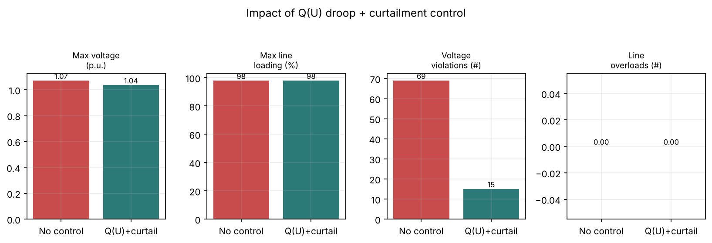
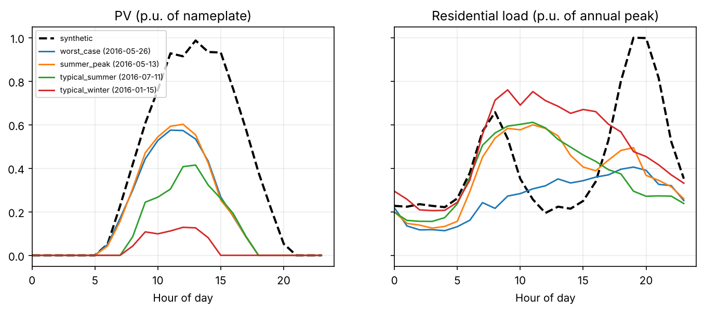
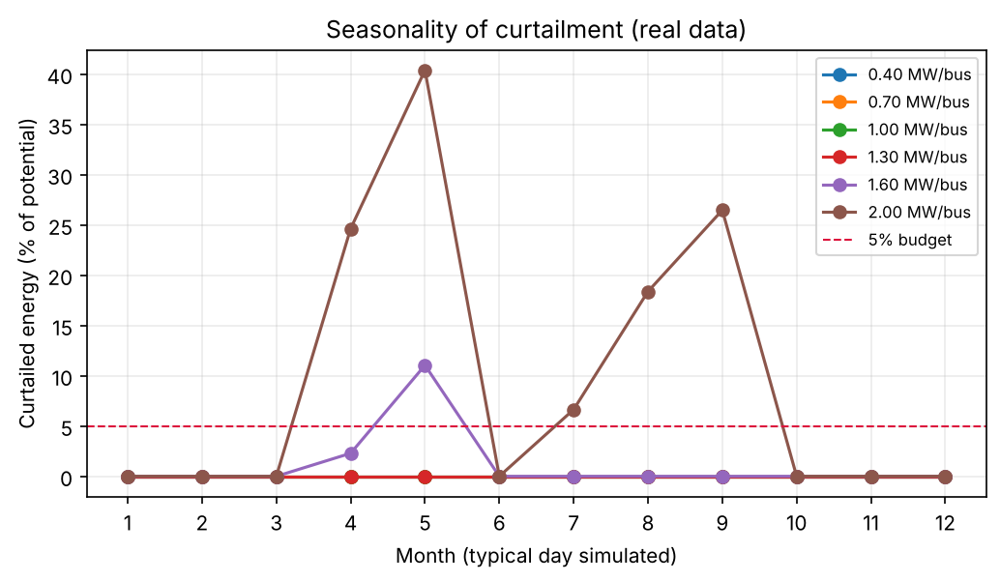
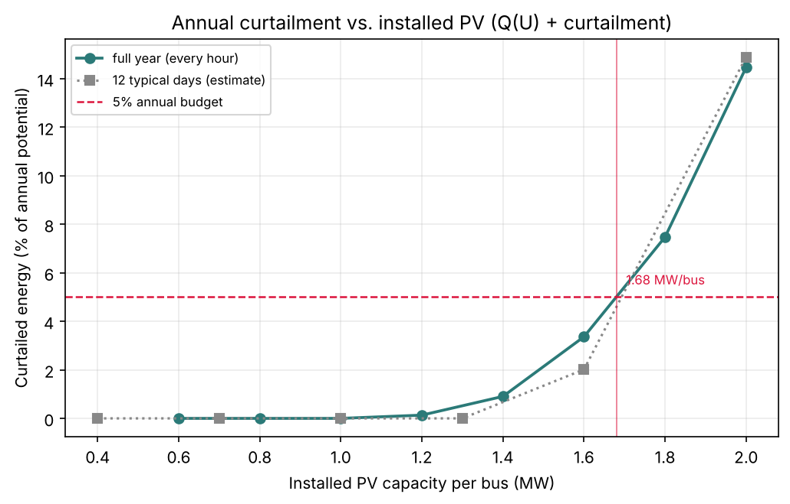
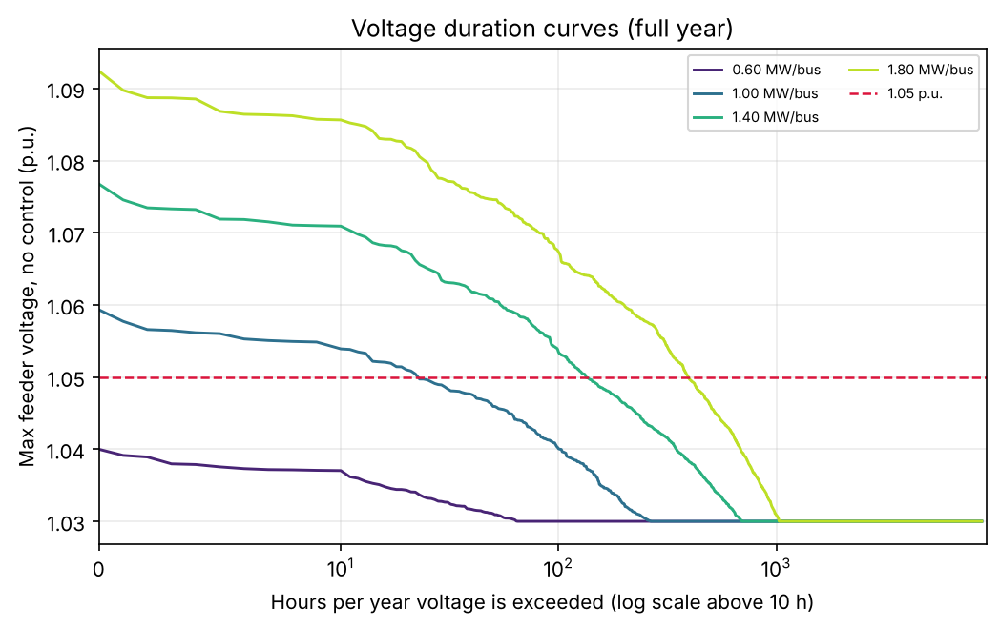
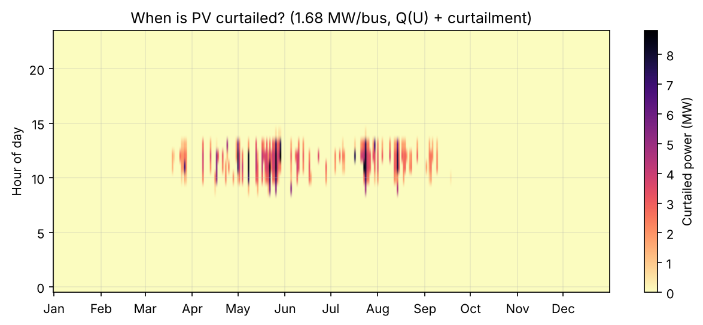
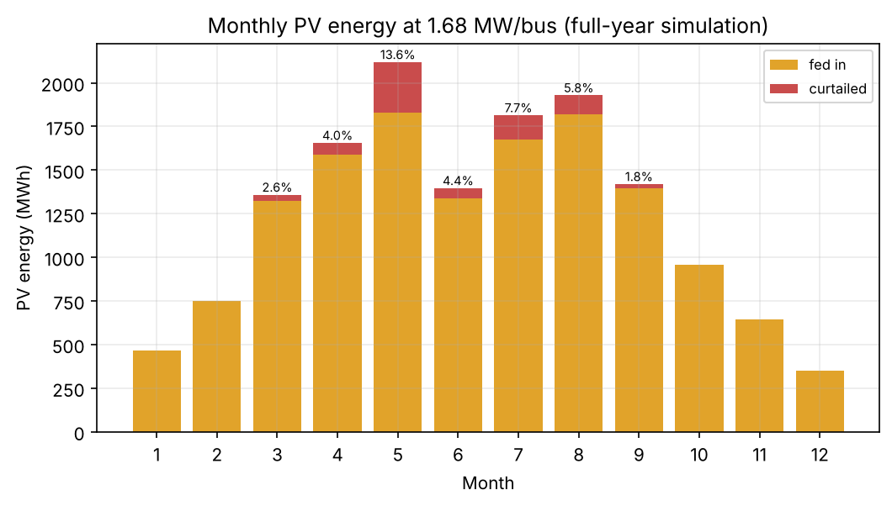

# Renewable Hosting Capacity & Bottleneck Analysis

Time-series AC power flow study of how much solar PV a medium-voltage
distribution feeder can absorb before voltage and thermal limits are
violated — and how much of that limit can be recovered with active
DER control (Q(U) reactive power droop + automated curtailment)
instead of network reinforcement.

Built with [`pandapower`](https://www.pandapower.org/) on the CIGRE
medium-voltage benchmark network (residential + commercial feeder), driven
either by synthetic design-day profiles or by **a full year of real,
measurement-based load and PV data** (SimBench 2016, 15-min), with PVGIS
or your own CSV as alternative PV sources.


## Why this is more than the standard tutorial

pandapower ships an official hosting-capacity example (static, single
worst-case snapshot, PV added iteratively bus-by-bus until something
breaks). It's a good starting point, and this project builds
noticeably past it:

| | Standard tutorial | This project |
|---|---|---|
| Time resolution | one worst-case snapshot | full 24h time series (hourly or 15-min) |
| Mitigation | none — just reports the limit | Q(U) droop control **and** automated curtailment, both implemented as real pandapower `Controller` subclasses |
| Input data | synthetic | synthetic design day **or** a full year of real data (SimBench / PVGIS / own CSV), with automatic selection of worst-case, seasonal and monthly typical days |
| Capacity metric | hard MW ceiling | per-bus MW ceiling, zero-violation capacity with/without Q(U), **and** a curtailment-energy-budget search on a design day *and on an annual basis* (the metric DSOs actually use once curtailment is on the table) |
| Validation | — | 29 unit tests, incl. regression tests for five real bugs found during development (see below) |

## Methodology

1. **Network**: CIGRE MV benchmark, residential branch, loaded via
   `pandapower.networks.create_cigre_network_mv()` — 15 buses, 2
   transformers, one external grid, ~44.7 MW / 11 MW aggregate peak
   load.
2. **Profiles**: either synthetic but physically-shaped 24h curves — a
   double-peaked residential load curve, a clear-sky PV curve with
   cloud-transient noise, and an autocorrelated stochastic wind curve
   (`src/profiles.py`) — or real data (`src/real_data.py`, see
   [Real data](#real-data) below): separate residential and commercial
   load curves mapped onto the CIGRE `Load R*` / `Load CI*` elements,
   and a measured PV feed-in curve.
3. **Per-bus hosting capacity** (`hosting_capacity.per_bus_snapshot_capacity`):
   bisection-search, at the single worst-case time step (max PV ÷ min
   load ratio), of the largest standalone PV capacity each candidate
   bus can host before a voltage (`0.95–1.05` p.u.) or thermal
   (100% loading) limit is violated.
4. **Time-series impact of control** (`run_study.py`, steps 2-3): the
   same uniform PV capacity is simulated across the full day twice —
   once with no control, once with Q(U) droop and curtailment engaged
   — and the violation counts / peak voltages / peak loadings are
   compared directly.
5. **Curtailment-budget capacity** (`hosting_capacity.capacity_with_curtailment_budget`):
   because curtailment can force *any* nameplate capacity into
   voltage/thermal compliance by simply clipping harder, a
   zero-violation search against curtailed capacity is degenerate. The
   economically meaningful question is instead *how much capacity can
   be installed before curtailed energy exceeds an acceptable planning
   budget* (default 5% of potential PV yield, a common DSO
   convention) — this is what section 4 of `run_study.py` searches for.

### Control strategies implemented

- **Q(U) droop** (`control.QUDroopController`): a continuous,
  grid-code-style piecewise-linear characteristic — full reactive
  injection below `v1`, ramping to zero through the deadband
  `[v2, v3]`, ramping to full absorption above `v4`. Reactive headroom
  is derived from each inverter's assumed apparent-power rating
  (33% of rated P, i.e. cos φ ≈ 0.95).
- **Active-power curtailment** (`control.CurtailmentController`): a
  last-resort controller that only engages once Q(U) support alone
  can't clear a violation, ramping active power down in fixed steps
  until the network is compliant or a configurable curtailment floor
  is hit. Tracks cumulative curtailed energy (MWh) for the budget
  search above.

Both are implemented as proper `pandapower.control.basic_controller.Controller`
subclasses with `is_converged` / `control_step`, so they plug directly
into `pandapower.timeseries.run_timeseries` and are re-solved to a
fixed point at every time step alongside the load/PV profile
controllers — not a simplified post-processing pass.

## A real bug found (and fixed) along the way

Worth calling out because it's the kind of thing that actually shows
up in production power-system code: the first version of the Q(U)
droop curve had a **discontinuous jump** at the `v1` boundary (full
injection, then an instant drop to zero) instead of a ramp. For buses
sitting near that boundary, the discontinuity caused the iterative
time-series solver to bounce back and forth across it forever —
`ControllerNotConverged`, no fixed point. Fixed by making the
characteristic properly continuous and adding under-relaxation
(damping) to the iterative update.
`tests/test_control.py::test_droop_factor_is_continuous_no_jump_at_v1`
is a regression test for exactly this.

A second, sneakier bug: reusing the same `net` object across two
consecutive time-series runs silently corrupted the load scaling,
because the second run read `net.load.p_mw` to determine "nominal"
load — but that column had already been overwritten by the first
run's last time step. Fixed by freezing `p_mw_nominal` /
`q_mvar_nominal` once at network build time and always scaling from
those. See `network.build_network()` and
`tests/test_network.py::test_nominal_load_columns_are_frozen`.

### Three more bugs found while adding real data

Moving from one synthetic day to a year of real data stress-tested the
code and surfaced three more problems, each now covered by a test:

1. **Curtailed energy under-reported 4× at hourly resolution.**
   `CurtailmentController` converted curtailed MW to MWh with a
   hard-coded `× 15/60`, but the default study runs hourly. Every
   curtailment percentage was therefore 4× too low. The step length is
   now taken from the profile's time index
   (`tests/test_real_data.py::test_curtailed_energy_uses_actual_step_length`
   checks that hourly and 15-min runs give the same MWh).
2. **Q(U) limit cycle at high PV penetration.** Above ~1.3 MW/bus the
   fixed under-relaxation factor (0.5) sat exactly on the stability
   boundary of the fixed-point iteration (local loop gain k ≈ 3, and
   convergence needs α(1+k) < 2), giving a period-2 oscillation and
   `ControllerNotConverged`. Fixed with *adaptive* damping (α halves
   whenever the update reverses direction)
   (`tests/test_control.py::test_qu_control_converges_on_heavily_loaded_feeder`).
3. **Curtailment reacting to under-voltage.** The curtailment controller
   treated `v < v_min` as a violation and clipped PV during evening load
   peaks, which can only make an under-voltage *worse*. Likewise the
   zero-violation hosting-capacity search counted load-driven
   under-voltage, so on the synthetic day it returned **0 MW** for every
   strategy. Both now consider only PV-caused violations (over-voltage,
   overloading) (`tests/test_control.py::test_curtailment_ignores_undervoltage`).

A data issue too: SimBench time stamps are local time *with*
daylight-saving shifts (27 March has 92 quarter-hours, 30 October 100), so
the index is re-labelled on a regular CET grid (`data/README.md`).

## Results

### Synthetic design day

At 0.7 MW of PV installed per candidate bus (13 buses, 9.1 MW total —
a deliberately stressed case):

| Metric | No control | Q(U) + curtailment |
|---|---|---|
| Max bus voltage | 1.071 p.u. (violation) | 1.036 p.u. (compliant) |
| Over-voltage bus-steps (24h) | 45 | 0 |
| Under-voltage bus-steps (24h) | 24 | 15 (evening load peak, not caused by PV — see below) |
| Max line loading | 97.9% | 98.0% |
| Line overloads | 0 | 0 |

Uniform hosting capacity on the synthetic day: **0.41 MW/bus** without
control, **0.66 MW/bus** with Q(U) droop, **0.70 MW/bus** with Q(U) +
curtailment at a 5 % curtailed-energy budget.



### Real data

`python src/run_study.py --data simbench` (outputs in `results/real_data/`,
including CSV tables for every figure):

| Hosting-capacity definition (uniform PV at all 13 buses) | MW/bus | Feeder total |
|---|---|---|
| No control, zero violations on the worst-case day (26 May) | 0.82 | 10.7 MW |
| Q(U) droop, zero violations on the worst-case day | 1.18 | 15.4 MW (+44 %) |
| Q(U) + curtailment, ≤ 5 % curtailed on the worst-case day | 1.17 | 15.2 MW |
| Q(U) + curtailment, **≤ 5 % curtailed over the year** | **1.69** | **22.0 MW (+106 %)** |

Key observations:

1. **Synthetic profiles roughly halve the hosting capacity.** The
   synthetic PV curve peaks at 1.0 p.u. of nameplate and the synthetic
   load peaks every day, so the design day combines a peak that real PV
   never reaches (0.62 p.u. here, due to inverter/temperature/
   orientation losses) with an unrealistically high evening load
   (0.41 → 0.82 MW/bus without control).
   
2. **Over-voltage is the first limit; thermal limits follow.** On the
   representative days line loading stays below ~60 % and over-voltage at
   the end of the feeder (bus 14 has the lowest per-bus capacity) sets the
   limit, which is why Q(U) alone already buys +44 %. The full-year run
   (below) shows lines reaching ~100 % above 1.4 MW/bus, so at high
   penetration curtailment is also managing thermal limits.
3. **An annual budget is far less restrictive than a design-day one.**
   Over-voltage only happens on a few clear spring/summer days with low
   load, so 5 % of *annual* yield lets you install ~45 % more PV than
   5 % of the worst day's yield.
   
4. **The under-voltage seen in the synthetic study is an artifact.**
   With real profiles the minimum voltage stays ≥ 0.97 p.u. all year,
   because real demand rarely reaches the coincident peak that the
   synthetic curve hits every evening.

Seasonal comparison at 0.7 MW/bus (`results/real_data/seasonal_comparison.png`)
and the full input-data year (`results/real_data/real_data_annual_overview.png`)
are also generated.

### Full-year simulation (8784 h)

`python src/annual_study.py --workers 4` simulates every hour of 2016
(a leap year, hence 8784 h) for a sweep of capacities. Outputs are in
`results/annual/`.

**Critical time-step screening.** With Q(U) and curtailment active, each
hour needs ~8 iterated power flows, so a brute-force controlled year takes
~25 min *per capacity*. Instead (`src/annual.py`):

1. simulate the whole year **without control** (1 power flow per hour),
2. flag *critical* hours: PV producing and uncontrolled max voltage
   > 1.03 p.u. (0.02 p.u. margin) or line loading > 90 %,
3. re-simulate **only those hours** with the controllers.

This gives the same answer as controlling every hour, because both
controllers reset at every time step (hours are independent) and Q(U) can
only lower voltages above 1.02 p.u. Validation against a fully controlled
simulation (1–7 May, 1.6 MW/bus) gives identical curtailed energy
(25.457 MWh) and peak voltage, with 25 instead of 72 hours under
control (`results/annual/screening_validation.csv`,
`tests/test_annual.py::test_screening_matches_full_control`). At the
highest capacity, 1 193 of 8 784 hours (14 %) are critical. The whole
study (8 capacities on 4 cores, a verification run and two full-year
bisections) takes ~40 min.

**Results** (uniform PV at all 13 buses):

| Hosting-capacity definition | Full year | Design / typical days (`run_study.py`) |
|---|---|---|
| No control, zero violations | **0.80** MW/bus (10.4 MW) | 0.82 (worst-case day) |
| Q(U) only, zero violations | **1.13** MW/bus (14.7 MW) | 1.18 (worst-case day) |
| Q(U) + curtailment, ≤ 5 % annual curtailment | **1.68** MW/bus (21.8 MW) | 1.69 (12 typical days) |

Verification run at 1.68 MW/bus: 4.91 % curtailed (730 of 14 863 MWh),
spread over 234 hours.



What the full year adds:

1. **The "worst-case day" is not quite the worst case.** Choosing the
   design day by maximum PV/load ratio *overestimates* the zero-violation
   capacity by 2.5–4.5 % (0.82 → 0.80 without control, 1.18 → 1.13 with Q(U)).
   The binding hours lie on other days, where load, PV and the Q(U)
   operating point combine differently. Only a full-year simulation
   catches them.
2. **12 typical days estimate the budget capacity well (1.69 vs 1.68
   MW/bus), but not the curve.** The typical-day estimate under-predicts
   curtailment at 1.4–1.6 MW/bus by up to 40 % (2.0 % vs 3.4 % at 1.6)
   and (interpolated) over-predicts it around 1.8. That it matches at 5 %
   is partly luck.
3. **Violation *duration* matters.** Voltage duration curves show that at
   1.0 MW/bus the 1.05 p.u. limit is exceeded for only 23 h/yr, yet a
   zero-violation rule lets those 23 hours rule out the capacity. This is
   the core argument for curtailment-based planning.
   
4. **Curtailment is concentrated in spring.** At the budget capacity, May
   alone loses 13.6 % of its potential yield (≈ 40 % of the annual
   curtailed energy), while October–February lose nothing. All of it
   falls between 08:00 and 14:00.
   
   

### Limitations (worth discussing in a report)

* **12 typical days** (`run_study.py`) are a rough approximation of the
  year: individual months are noisy (May's typical day curtails 40 % at
  2 MW/bus, June's 0 %). Use `annual_study.py` for annual figures.
* **Hourly resolution** averages out short PV peaks (cloud edges). Run
  `annual_study.py --fine` for 15-min steps (≈ 4× slower).
* **The screening margin** (1.03 p.u.) is validated on a high-PV week, not
  proven for every possible network. Lower `--screen-v` if you change the
  Q(U) curve or the network.
* **Coarse, uniform curtailment.** The controller curtails all units
  together in 20 % steps, so curtailment jumps from 0 % to 8 % between
  1.17 and 1.2 MW/bus on the design day. Per-unit, finer or OPF-based
  curtailment would give a smoother curve and slightly higher capacity.
* **Q headroom scales with current P** (`s_max = p / 0.95`), so
  reactive support shrinks at low irradiance. Grid codes usually rate Q
  against the inverter's fixed apparent-power rating.
* **Curtailment also responds to load-driven line overloads**, which it
  cannot fix. This doesn't affect any result shown here (max line
  loading stays ≤ 98 %).
* One network, one data year, uniform PV placement: see
  [Possible extensions](#possible-extensions).

## Project layout

```
src/
  network.py            network loading, candidate buses, DER attachment
  profiles.py           synthetic load / PV / wind profile generator
  real_data.py          real data: SimBench year, PVGIS fetch, CSV loader, day selection
  annual.py             full-year simulation with critical time-step screening
  annual_study.py       full-year (8784 h) study entry point
  control.py             Q(U) droop + curtailment pandapower controllers
  timeseries_sim.py     time-series simulation wiring (ConstControls, OutputWriter)
  hosting_capacity.py   bisection search algorithms (snapshot + time-series + budget)
  analysis.py            plotting
  run_study.py           end-to-end CLI entry point
tests/                  35 unit tests (network, profiles, control, real data, annual)
data/                   cached SimBench 2016 profiles + provenance (data/README.md)
results/                 synthetic-run plots
results/real_data/       real-data run plots and CSV tables (design / typical days)
results/annual/          full-year run plots and CSV tables
```

## Running it

```bash
pip install -r requirements.txt
python src/run_study.py --capacity-mw 0.7 --budget-pct 5.0   # synthetic (~3 min)
python src/run_study.py --data simbench                    # real data (~10 min)
python src/run_study.py --data pvgis --lat 52.52 --lon 13.40 --pv-year 2020
python src/run_study.py --data csv --pv-csv data/my_pv.csv
python src/run_study.py --data simbench --day typical_winter --skip-annual
python src/annual_study.py --workers 4                     # full year (~20 min)
python -m pytest tests/ -v
```

Use `--fine` for 15-minute resolution (96 steps/day) instead of the
default hourly resolution — slower but finer-grained.

## Possible extensions

- PVGIS data for several locations / years to test how sensitive the
  hosting capacity is to climate and weather year.
- Stochastic/Monte-Carlo placement of PV across buses rather than
  uniform capacity, to get a probabilistic hosting-capacity
  distribution.
- Optimal power flow (OPF)-based curtailment instead of the local
  rule-based controller, to minimize curtailed energy network-wide
  rather than per-bus.
- Extend to the larger `mv_oberrhein` network (179 buses, real
  MV/LV topology) for a more realistic scale.

## License

MIT — see `LICENSE`.
